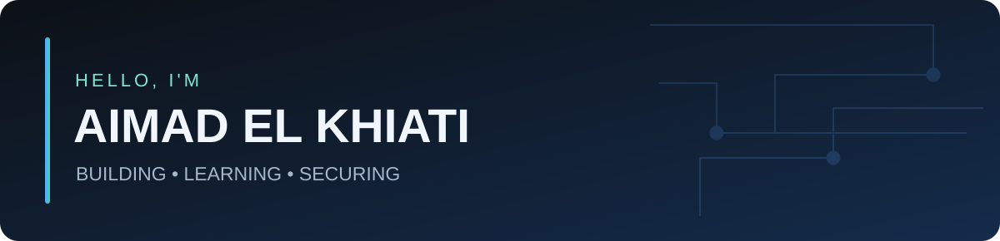

### Software Engineering Student · Full-Stack Development · Cybersecurity

## 👨‍💻 About me

I'm **Aimad**, a software engineering student at **EMSI**, interested in building useful applications and exploring **cybersecurity**, **AI/ML**, and modern web development.

- 🔭 Building educational tools and full-stack projects
- 🌱 Learning more about cybersecurity, Linux, networking, and AI
- 🧩 Interested in clean interfaces, practical solutions, and reliable systems
- 📍 Morocco

## 🛠️ Tech & tools

> Technologies I use or am learning — not a claim of expertise in every tool.

## 🚀 Featured work

| Project | What it does | Links |
|:--|:--|:--|
| **Study Hub EMSI** | Educational platform developed as a third-year end-of-year project | [Website](https://study-hub-emsi.me) |
| **Study Hub Morocco** | Learning platform focused on digital-development students, courses and interactive practice | [Website](https://study-hub-mar.tech) · [Repository](https://github.com/elkhiati-aimad/STUDDY-HUB-MOROCCO) |
| **YFAH** | Marketplace-related collaborative development work | [Repository](https://github.com/SI4MA/YFAH) |

## 📊 GitHub activity

<!-- OPTIONAL: Enable the workflow in .github/workflows/snake.yml to generate the snake SVG.
     Then uncomment the next two lines after its first successful run.
## 🐍 Contribution snake

-->

## 🤝 Let's connect

I'm open to learning, collaborating on meaningful projects, and connecting with developers.

**[LinkedIn](https://www.linkedin.com/in/aimad-el-khiati/)** · **[GitHub](https://github.com/elkhiati-aimad)**

